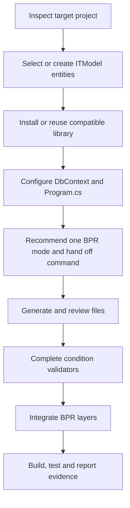

# AutoGenerator API Skills

[](https://skills.sh/asgmodel/autogenerator-api-skills)

Agent skills for ASP.NET Core backend generation with [WasmAI.AutoGenerator.API](https://github.com/asgmodel/WasmAI.AutoGenerator.API). The initial release contains one core skill, with focused references for each generation mode. It guides an AI coding agent in using the upstream generator; installing the skill does not install the .NET package or generate code on its own.

## Install

Run inside the consuming project with a supported Node.js version and the [Skills CLI](https://www.skills.sh/docs/cli):

```bash
npx skills add asgmodel/autogenerator-api-skills --list
npx skills add asgmodel/autogenerator-api-skills --skill autogenerator-api-skills
```

For Codex specifically:

```bash
npx skills add asgmodel/autogenerator-api-skills --skill autogenerator-api-skills -a codex
```

To inspect the unpacked local project from its root instead, use `npx skills add . --list`.

## Use

Open the target ASP.NET Core project in your coding agent and request, for example:

> Use autogenerator-api-skills to inspect my Product entity, generate Builder CRUD in an isolated checkout, preserve custom code, and report the build and test results.

The agent follows the [mandatory core generation procedure](skills/autogenerator-api-skills/references/generation.md) for new or complete backends. For targeted fixes it reuses existing stages.



The agent provides the package link, actual project directory and ready-to-run generation command; execution is optional when requested and available. The default for a simple new CRUD resource is Builder, not every mode at once.

## Sections

| Section | Coverage |
| --- | --- |
| Host and model | .NET 8 snapshot, EF Core, ITModel, DbContext and assembly discovery |
| Generation | Standard CRUD, BPR Builder DTO, Share DTO and DSO |
| Integration | Controllers, repositories, validators, DI and AutoMapper |
| ConditionChecker runtime | [Source-reviewed contracts, binding, lookup and failure behavior](skills/autogenerator-api-skills/references/condition-checker.md) |
| Validator generation | [Canonical C# template, Product/Category examples and checker usage](skills/autogenerator-api-skills/references/validator-generation.md) |
| Condition Validators | [Attribute registration, feature keys, typed filters and nested checks](skills/autogenerator-api-skills/references/condition-validators.md) |
| Infrastructure | SQL Server, Swagger and authentication configuration |
| AI-native generation | [Agent-driven model/validator generation, DI and procedure integration](skills/autogenerator-api-skills/references/ai-generation.md) |
| Architecture | [Minimal dependency and verification ontology](skills/autogenerator-api-skills/references/architecture.jsonld) |
| Quality | Safe regeneration, build, tests and troubleshooting |

Read the [core skill](skills/autogenerator-api-skills/SKILL.md), [generation guide](skills/autogenerator-api-skills/references/generation.md), [source compatibility notes](skills/autogenerator-api-skills/references/repository.md) and [usage scenarios](skills/autogenerator-api-skills/references/examples.md).

## Generator commands

The original reference was reviewed against a specific upstream commit. Verify the installed version and run from the consuming startup project, ideally in an isolated checkout:

```bash
dotnet run -- generate
dotnet run -- generate /bpr c:build
dotnet run -- generate /bpr c:share
dotnet run -- generate /bpr c:dso
dotnet run -- generate /bpr c:all
```

Select one mode for the requested task; these are alternatives, not a mandatory sequence. The reviewed parser handles c:all differently from SetGenType; verify actual output before recommending it. For the source-documented installation see [NuGet](https://www.nuget.org/packages/WasmAI.AutoGenerator.API) and the core procedure. Check the generated files, preserve manual logic, build and run available tests. See the generation guide for merge and auth flags and their caveats.

## Repository layout

```text
skills/
  autogenerator-api-skills/
    SKILL.md
    agents/openai.yaml
    assets/icon.svg
    assets/templates/ValidatorContext.cs.txt
    assets/examples/validators/  # Model and validator examples
    references/
      generation.md
      repository.md
      examples.md
      condition-validators.md
      condition-checker.md
      validator-generation.md
      ai-generation.md
      architecture.jsonld
README.md
```

## Publishing and maintenance

Verify discovery with the `--list` command and install the skill from the public repository. The Skills.sh leaderboard is based on installation telemetry; publication alone does not guarantee immediate listing. See the [Skills.sh FAQ](https://www.skills.sh/docs/faq).

Keep detailed generator and procedure examples in the references directory as they become available. Do not claim runtime compatibility without checking the resolved package and running the relevant tests. No upstream source code is bundled in this repository; the provided skill references an upstream source snapshot.

## Verification

```bash
python3 scripts/check_skill.py
bash scripts/test-validators.sh
```

The runtime harness requires Git, .NET 8 and network access to GitHub/NuGet. It tests the pinned Checker source (declares 1.0.0) and package 1.0.1 referenced by the AutoGenerator API, using actual wrapper source and an in-memory host adapter. It compiles the shared example assets; it does not replace the target application's EF integration tests. Check GitHub Actions or the local exit status for actual results.
