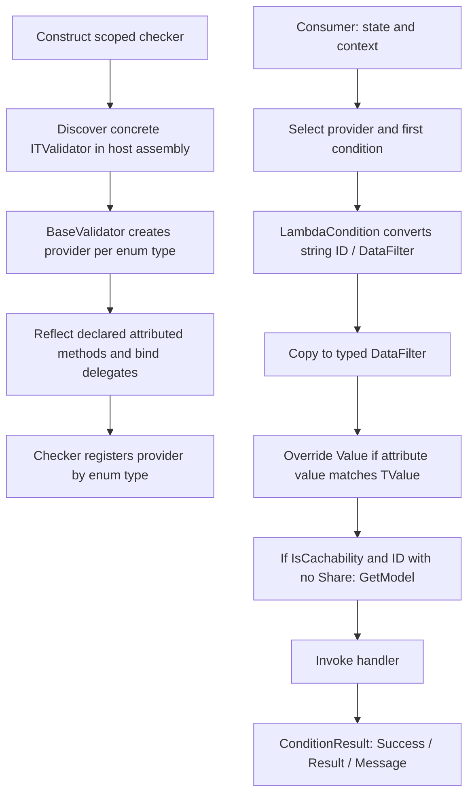

# ConditionChecker contract (source-reviewed)

## Version boundary

Source: [WasmAI.ConditionChecker @ 8cba67f](https://github.com/asgmodel/WasmAI.ConditionChecker/tree/8cba67f2d8b07a1cb6595b7d88317f0488186c6c), whose csproj declares 1.0.0. [WasmAI.AutoGenerator.API @ 4ef638f](https://github.com/asgmodel/WasmAI.AutoGenerator.API/tree/4ef638f1d1c6209d633f76e1d5bc6b8e309dff02) references package 1.0.1. Do not assume identical binaries. Inspect the target's resolved package or matching source and run the contract tests for it. The rules below describe the pinned source, not proof of the published package's behavior.

## Actual execution



| Contract | Observed behavior |
| --- | --- |
| [Attributes](https://github.com/asgmodel/WasmAI.ConditionChecker/blob/8cba67f2d8b07a1cb6595b7d88317f0488186c6c/Base/Attributes.cs) | RegisterConditionValidator allows multiple attributes per method. State must belong to the validator's enum; EnumType metadata does not route to a different provider. IsCachability defaults true. BuildConditionValidator exists but the inspected context discovers RegisterConditionValidator only. |
| [BaseValidator](https://github.com/asgmodel/WasmAI.ConditionChecker/blob/8cba67f2d8b07a1cb6595b7d88317f0488186c6c/Validators/Validator.cs) | Constructor invokes Initializer then registers its provider. InitializeConditions must not depend on derived constructor fields already being initialized. |
| [TBaseValidatorContext](https://github.com/asgmodel/WasmAI.ConditionChecker/blob/8cba67f2d8b07a1cb6595b7d88317f0488186c6c/Validators/TBaseValidatorContext.cs) | Reflection uses DeclaredOnly, public/private instance methods. It binds Func<DataFilter<TValue,TModel>,Task<ConditionResult>> using the first generic argument of the parameter. Wrong Share type or incompatible method signature can break registration. Inherited attributes in BaseValidatorContext are not automatically discovered for concrete validators. |
| [DataFilter](https://github.com/asgmodel/WasmAI.ConditionChecker/blob/8cba67f2d8b07a1cb6595b7d88317f0488186c6c/Base/DataFilter.cs) | Base filter holds Id, Name, Share, Value and Items. Generic properties hide (new) base properties; the copy constructors only accept values matching T and E, not general conversions. Pass a non-generic DataFilter at the checker boundary. |
| [LambdaCondition and ConditionResult](https://github.com/asgmodel/WasmAI.ConditionChecker/blob/8cba67f2d8b07a1cb6595b7d88317f0488186c6c/Base/Conditions.cs) | Accepts DataFilter, string ID (wraps it), or null (empty filter for DataFilter). Arbitrary model objects are not accepted by this handler path. Exceptions are returned as failure, with exception message; sanitize external responses. |
| [Provider](https://github.com/asgmodel/WasmAI.ConditionChecker/blob/8cba67f2d8b07a1cb6595b7d88317f0488186c6c/Checker/ConditionProvider.cs) | Stores list per enum member. Get selects first; provider.Check tries until first success. Do not register multiple handlers for one state expecting AND semantics. |
| [Checker](https://github.com/asgmodel/WasmAI.ConditionChecker/blob/8cba67f2d8b07a1cb6595b7d88317f0488186c6c/Checker/BaseConditionChecker.cs) | Provider dictionary keyed by enum Type, replacement on RegisterProvider; same enum type in two validator classes can overwrite previous provider. Use one owner per enum type, unique numeric values within it, preserve persisted values. Different enum types may share numeric values. |

## Value and model resolution

- Caller-supplied comparison: leave attribute Value unset; invoke with `new DataFilter { Id = id, Value = expected }`. For mandatory value types use nullable TValue (e.g. bool?) and require HasValue or a type pattern; otherwise an absent/wrongly typed input silently defaults to false or zero. Do not convert a string "false" automatically.
- Fixed rule: set attribute Value to an actual constant of the matching type. It overrides the caller's typed value after copying, before model resolution. Several distinct states can share one method and have different constants. A string feature name such as "category" overrides an actual requested string; it is NOT a feature-key lookup. Keep external feature keys in an explicit host mapping or Name/Items as appropriate, not attribute Value for dynamic comparison.
- `IsCachability` controls MapTo/GetModel, not a result cache. Default true: fetch when Id != null and typed Share is null. False: do not fetch; require supplied model/value as appropriate. Existing Share wins even when Id differs. Never trust client Share for persisted existence, ownership or authorization; use a trusted loaded model or ID-only lookup with actual tenant constraints. The original EF adapter uses FindAsync; it is not an authorization policy.
- Prefer base GetModel. No static cache; keep scoped EF context. If calling with a typed filter populated through hidden properties, the generic copy reads base values and can lose them. Use plain DataFilter with boxed Value/Share at dispatch; inside the handler use the typed properties.
- Avoid using DataFilter<T> alone in attribute handlers of TBaseValidatorContext; the actual delegate shape is DataFilter<TValue,TModel>. Inspect different base classes separately.

## Result factories and consumers

```csharp
// Non-async Task handler:
return ConditionResult.ToFailureAsync(null, "Readable error.");
// Async handler after await:
return ConditionResult.ToFailure(null, "Readable error.");
```

A one-argument ToFailureAsync("error") compiles but puts text in Result, not Message. ToErrorAsync(message) sets Message with null Result. Success is nullable; only Success == true passes. Successful payload contract should be explicit; never expose full entity/secrets or internal exceptions by default.

Use CheckAndResultAsync for result and reason, CheckAsync for bool-only. Missing provider/state fails for these single-state APIs. Prefer explicit ordered checks or composite states with early return, not blanket CheckAllAsync. Avoid the following for mandatory gates in this snapshot:

| API | Risk from source |
| --- | --- |
| CheckAllAsync | Skips unregistered enum states; empty results.All is true. |
| CheckWithMultipleContextsAsync / CheckWithContextualDependenciesAsync | Return true when provider/state missing, contexts empty, or result success null. |
| CheckWithErrorASync / CheckWithError | Return true for a non-null failed result; the Async form blocks internally. |
| Provider.Check | Any-success semantics and generic failure rather than original failure. |
| ResetConditionState / AreAllConditionsMetWithRetryAsync | Not implemented. |
| GetConditionHistoryAsync | Re-evaluates conditions; not an actual stored audit history. |
| CheckWithContextDataAsync | additionalData is not used in the inspected implementation. |

## AutoGenerator host integration

AutoGenerator supplies thin wrappers around the checker and a generated host ValidatorContext. [ValidatorGenerator](https://github.com/asgmodel/WasmAI.AutoGenerator.API/blob/4ef638f1d1c6209d633f76e1d5bc6b8e309dff02/WasmAI.AutoGenerator.Coder/Code/ValidatorGenerator.cs) scaffolds host infrastructure; the agent supplies business predicates. [Config](https://github.com/asgmodel/WasmAI.AutoGenerator.API/blob/4ef638f1d1c6209d633f76e1d5bc6b8e309dff02/WebApplication1/v1/Validators/Conditions/Config.cs) registers checker and injector scoped and discovers validators via executing assembly. [Generated checker](https://github.com/asgmodel/WasmAI.AutoGenerator.API/blob/4ef638f1d1c6209d633f76e1d5bc6b8e309dff02/WebApplication1/v1/Validators/Conditions/ConditionChecker.cs) omits assignment of _injector; fix in target if present. Verify AddAutoValidator is called in normal startup; do not assume the API wrapper does it. The generated lookup uses the scoped context. Maintain one checker per scope and do not capture it from a singleton.

The standalone smoke harness in the repository tests the real pinned checker and API wrappers with an explicit in-memory host adapter (not EF). Target applications must additionally exercise real registration, EF lookup/authorization and installed binary contracts. See [validator generation](validator-generation.md).
